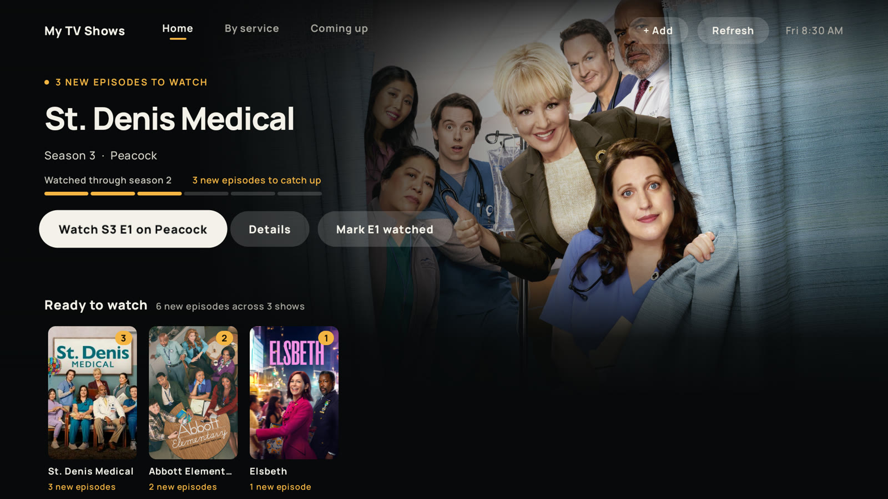
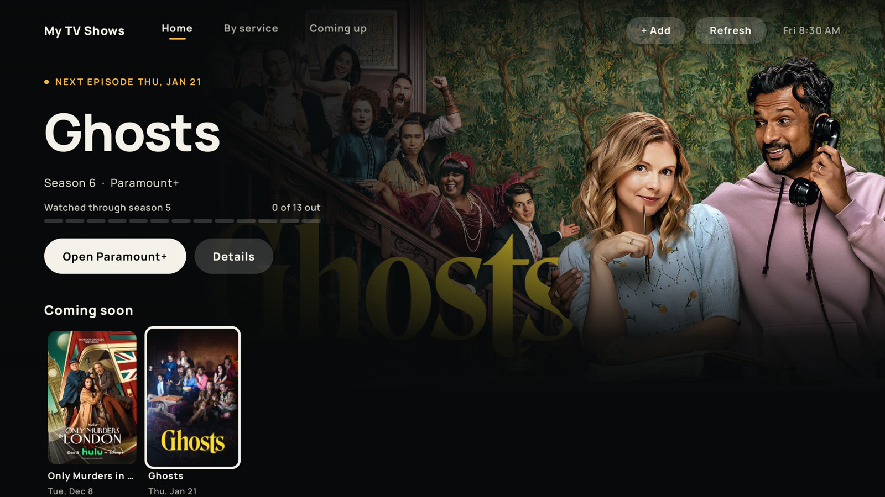
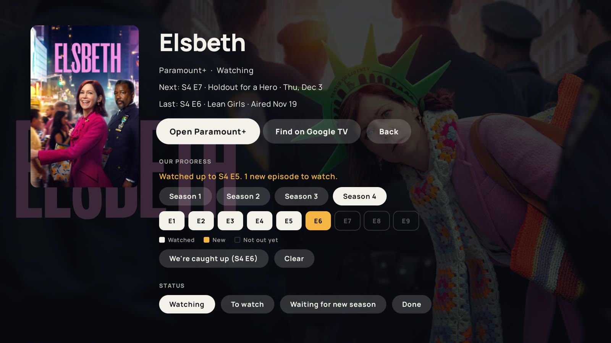
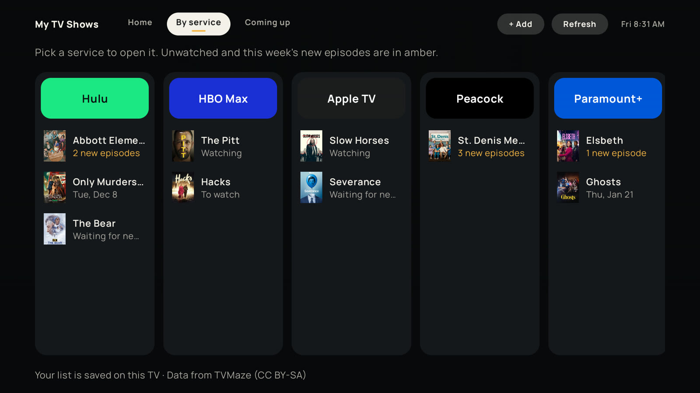
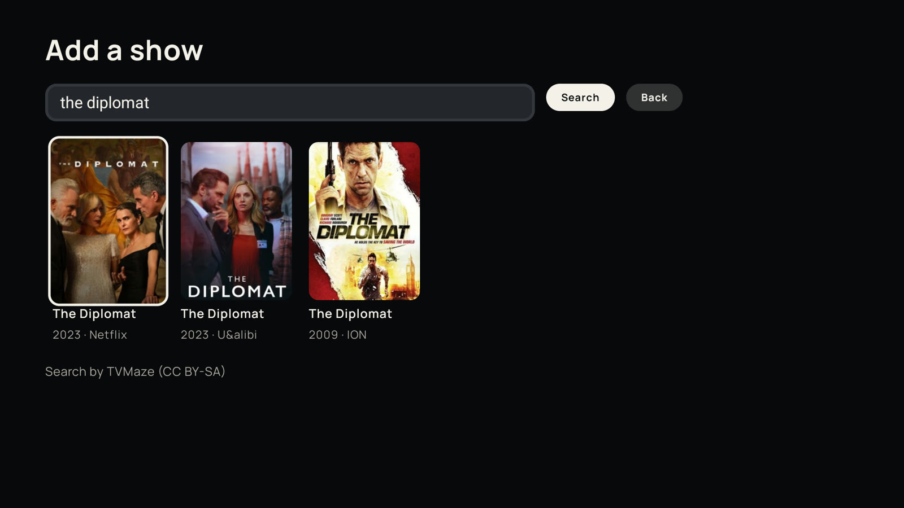

# My TV Shows

A Google TV app for keeping track of the shows your household watches:

- Add shows with the remote (search by title, pick where you watch it).
- See what's new this week, what's coming soon, and how many episodes you haven't watched yet.
- Jump straight into the right streaming app.

Your list is saved on your TV. No account or server needed. Show data comes from [TVMaze](https://www.tvmaze.com) (CC BY-SA).

**▶ [Watch the 30-second demo](docs/demo.mp4)** (with sound)

| | |
|---|---|
|  |  |
| **Home.** Move along a row and the big picture follows. | **Details.** Press the last episode you watched; new ones turn amber. |
|  |  |
| **By service.** Every show, grouped by where you watch it. | **Add.** Search by title (or the remote's mic), then pick the app. |

There's also a **Coming up** tab: new episodes arriving in the next 7 days.

Screenshots use sample shows. Posters and artwork come from TVMaze.

## Before you start: put your TV in developer mode

The app isn't in the Play Store, so your TV has to allow installs from your computer. You do this once, with the remote (about 2 minutes):

1. **Turn on developer mode.** Open **Settings > System > About**. Scroll to **Android TV OS build** and press it **7 times** in a row. You'll see "You are now a developer!"
   - On older Android TVs the path is **Settings > Device Preferences > About > Build**.
   - If it asks for your PIN or password, enter it.
2. **Turn on debugging.** Go back to **Settings > System > Developer options** (older TVs: **Settings > Device Preferences > Developer options**). Turn on **USB debugging**. If you also see **Network debugging** or **Wireless debugging**, turn that on too.
3. **Write down the TV's IP address.** It's under **Settings > Network & Internet**: pick your Wi-Fi or Ethernet connection. It looks like `192.168.1.42`.
4. **Allow your computer when asked.** The first time your computer connects, the TV shows **"Allow USB debugging?"**. Check **Always allow from this computer** and choose **Allow**.

Developer mode doesn't change anything else on the TV. You can turn it off later in Developer options. The app stays installed, but you'll need developer mode back on to install updates.

## Getting it on your TV

The easiest way is with [Claude Code](https://claude.com/claude-code):

1. Clone this repo and open the folder in Claude Code.
2. Say: **"Set this up on my TV."**

Claude follows [CLAUDE.md](CLAUDE.md): it installs the build tools, builds the app, and walks you through turning on debugging on the TV. You'll need the TV's remote nearby. It takes about 30 minutes the first time.

To update later: **"Pull the latest and update the app on my TV."**
